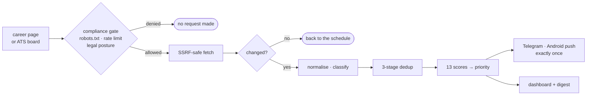

<p align="center">
  
</p>

<p align="center">
  <b>Never miss a relevant internship or new-grad role.</b><br>
  <sub>Scout is not a job board. It does not wait to be searched. It watches the places roles are announced, scores each one against you, and speaks up within minutes.</sub>
</p>

<p align="center">
  <sub>
    <a href="#overview">OVERVIEW</a> &nbsp;·&nbsp;
    <a href="#quick-start">QUICK START</a> &nbsp;·&nbsp;
    <a href="#how-it-works">HOW IT WORKS</a> &nbsp;·&nbsp;
    <a href="#the-ranking-model">RANKING</a> &nbsp;·&nbsp;
    <a href="#ground-rules">GROUND RULES</a> &nbsp;·&nbsp;
    <a href="#status">STATUS</a>
  </sub>
</p>

<br>

<table>
  <tr>
    <td><sub>SOURCES SEEDED</sub><br><b>~2,267</b></td>
    <td><sub>ATS ADAPTERS</sub><br><b>10</b></td>
    <td><sub>SCORES PER JOB</sub><br><b>13</b></td>
    <td><sub>DATA STORES</sub><br><b>1 (Postgres)</b></td>
    <td><sub>MONTHLY COST</sub><br><b>Zero, by design</b></td>
  </tr>
</table>

## Overview

Internship and new-grad roles appear on hundreds of company boards, often days before they reach an aggregator. Scout runs a discovery loop on a schedule, turns every posting into one canonical record, ranks it against your profile, and only interrupts you for the ones worth reading.

It covers software engineering, product, consulting and business roles. It is built for one person, running privately.

## Quick start

Docker and `make`. Go, Node and Python are only needed to run a service natively.

```bash
git clone https://github.com/kelyonn/scout.git && cd scout
make dev          # the whole stack, migrated and seeded
make test         # every suite, database-backed ones included
```

Open **http://127.0.0.1:3000** and sign in with `SCOUT_AUTH_TOKEN` from `.env`. The home page walks you through uploading a resume and running the collector.

> [!NOTE]
> Local development never touches the live internet unless you ask. `SCOUT_FIXTURES_ONLY=true` is the default, and the scheduler refuses to start until you turn it off. `make live-run` runs one bounded window against real sources.

## How it works

Four stages, each with its own failure domain. One source going dark costs you that source and nothing else.



| Stage | What happens |
|---|---|
| **Discovery** | A registry of sources is polled on an adaptive schedule: faster for sources that keep producing, slower for quiet ones. Adapters exist for Greenhouse, Lever, Ashby, Workday, SmartRecruiters, Workable, Recruitee, Teamtailor, Keka and Zoho Recruit, plus a generic career-page crawler. |
| **Ingestion** | Conditional fetches and layered change detection. Volatile noise like render timestamps is stripped before hashing, so a re-render is not mistaken for a change. |
| **Intelligence** | Normalisation into one role, location and skill taxonomy; deduplication so the same role on four sites is one job; local embeddings; and the ranking model. |
| **Delivery** | Telegram and native Android push under per-channel budgets and quiet hours, plus a full dashboard. |

## The ranking model

Every job gets thirteen scores, each specified in [`docs/09-ranking-scoring.md`](docs/09-ranking-scoring.md).

<table>
  <tr>
    <td valign="top"><sub>
      skill match<br>resume match<br>company quality<br>compensation<br>learning opportunity
    </sub></td>
    <td valign="top"><sub>
      engineering culture<br>growth potential<br>interview probability<br>competition<br>ease of applying
    </sub></td>
    <td valign="top"><sub>
      deadline urgency<br><b>overall match</b><br><b>priority</b>
    </sub></td>
  </tr>
</table>

Weights are versioned data, never constants in code, because changing a weight changes what wakes you up.

An LLM cascade (free hosted tiers, rotated, with local Ollama as the fallback) handles what rules cannot: ambiguous classification, near-duplicate adjudication, one-paragraph summaries, and a personal explanation of why a role matched. An eval harness gates all of it in CI.

## Ground rules

> [!IMPORTANT]
> **No request bypasses the compliance gate.** Sources whose terms prohibit access never generate a request anywhere in the code path.

- **No SSRF.** The destination IP is validated before connecting, on every request and every redirect.
- **No mocks where bugs hide.** Database tests run against real Postgres and Redis.
- **No public ingress.** Everything sits on a private Tailscale network behind one token.
- **No durable state in Redis.** Postgres holds everything that matters: data, search, vectors and the job queue.

## The dashboard

A ranked feed with filters, job detail with the AI summary, a personal match explanation and the full score breakdown, save, apply and dismiss with undo, a pipeline board, search, calendar, companies and watchlist, insights and resume upload. Responsive down to a phone, with every loading, empty, error and offline state handled.

## Status

**P1 (first real notification) and P2 (worth reading) are code-complete. P3 (daily driver) is under way.** Verified end to end against real Postgres and Redis, and on a real Pixel 7 with real push notifications.

**Not yet:** the full saved → applied → interviewing state machine, email-alert ingestion, GCC coverage, and observability. [`HANDOFF.md`](HANDOFF.md) is the current truth.

<details>
<summary><b>Configuration</b></summary>
<br>

| Variable | Purpose |
|---|---|
| `SCOUT_AUTH_TOKEN` | The single access token, 32+ characters |
| `SCOUT_DATABASE_URL`, `SCOUT_REDIS_URL` | Postgres with pgvector, and Redis |
| `SCOUT_FIXTURES_ONLY` | `true` by default |
| `SCOUT_NOTIFIER_TELEGRAM_BOT_TOKEN` | Telegram notifications |
| `SCOUT_FCM_PROJECT_ID`, `SCOUT_FCM_SERVICE_ACCOUNT_JSON` | Android push |
| `SCOUT_BRAIN_*_API_KEY` | Hosted LLM tiers; Ollama otherwise |
| `SCOUT_HOST_BIND_ADDR` | Bind to a tailnet IP for the Android app |

</details>

<details>
<summary><b>Architecture and layout</b></summary>
<br>

| Service | Language | Job |
|---|---|---|
| `apps/collector` | Go | scheduling, fetching, change detection, normalisation, scoring |
| `apps/brain` | Python | embeddings, the LLM cascade, summaries |
| `apps/notifier` | Go | triggers, budgets, delivery |
| `apps/api` | Go | HTTP API and auth |
| `apps/web` | Next.js | the dashboard |
| `apps/mobile` | Capacitor | Android shell with push |

```
apps/       collector · brain · notifier · api · web · mobile
packages/   db · schema · taxonomy · prompts · fetch · queue
adapters/   ats/<platform> · web/careerpage
infra/      compose · docker · migrations · scripts
evals/      golden sets and harnesses
docs/       22 spec documents and 20 ADRs
```

</details>

<details>
<summary><b>The twenty architecture decisions</b></summary>
<br>

Monorepo and language split · Postgres as the primary store · a job queue over Kafka · search strategy · the LLM cascade · deployment topology · no ToS-violating scraping · three-stage deduplication · frontend stack · authentication · observability · the native app shell · a WhatsApp channel · zero-cost hosting · single-user auth · a free-tier LLM cascade · backups without object storage · laptop-only hosting · a cardless hosted pipeline · expanding beyond software roles.

Each one lives in [`docs/adr/`](docs/adr/) with the alternatives considered and what would reopen it.

</details>

<br>

<sub>Private. Not licensed for redistribution.</sub>
